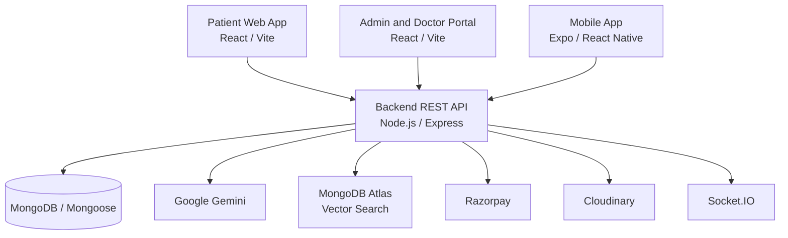

# Click2Clinic

Click2Clinic is a multi-platform healthcare management platform with
AI-assisted symptom guidance and RAG-based doctor recommendations. It connects
patients, doctors, laboratories, pharmacies, and administrators through a
shared backend API.

## Key Features

- Doctor discovery, speciality search, availability, and appointments
- Laboratory test discovery and booking
- Pharmacy browsing, cart, checkout, and order history
- Patient consultation and real-time communication workflows
- AI-assisted, non-diagnostic symptom guidance
- Doctor profile, schedule, appointment, and prescription workflows
- Administrative management for doctors, medicines, laboratories, orders, and
  appointments
- Patient web, administration/doctor web, and mobile applications

## Basic Architecture

Click2Clinic is organized as a monorepo with three clients connected to one
Node.js and Express API.



### Repository structure

```text
Click2Clinic/
├── backend/       # Express API, authentication, services, and database models
├── frontend/      # Patient-facing React application
├── admin/         # Administration and doctor React application
├── mobile/        # Expo and React Native application
└── package.json   # Root workspace scripts
```

### Technology stack

| Area | Technologies |
| --- | --- |
| Patient web | React 19, Vite, React Router, Tailwind CSS |
| Admin and doctor portal | React, Vite |
| Mobile | Expo, React Native, React Navigation |
| Backend | Node.js, Express, ES modules |
| Database | MongoDB, Mongoose |
| Authentication | JWT, bcrypt |
| AI and recommendations | Google Gemini, Gemini Embeddings, MongoDB Atlas Vector Search |
| Real-time communication | Socket.IO |
| Payments | Razorpay |
| Media uploads | Cloudinary, Multer |
| Maps | Leaflet, React Leaflet |

## Installation

### Prerequisites

- Node.js 18 or later
- npm
- A local MongoDB instance or a MongoDB Atlas connection
- Credentials for the external services used by the features you enable
- Expo tooling and an emulator or device for mobile development

### 1. Clone the repository

```bash
git clone <repository-url>
cd Click2Clinic
```

### 2. Install dependencies

Install dependencies for each workspace from the repository root:

```bash
npm install
npm install --prefix backend
npm install --prefix frontend
npm install --prefix admin
npm install --prefix mobile
```

### 3. Configure environment variables

Copy the example files and fill in the required values:

```bash
copy backend\.env.example backend\.env
copy frontend\.env.example frontend\.env
copy admin\.env.example admin\.env
copy mobile\.env.example mobile\.env
```

For macOS or Linux, use:

```bash
cp backend/.env.example backend/.env
cp frontend/.env.example frontend/.env
cp admin/.env.example admin/.env
cp mobile/.env.example mobile/.env
```

At minimum, configure `MONGODB_URI`, `JWT_SECRET`, and the backend URL used by
each client. Add Cloudinary, Razorpay, and Gemini credentials when those
integrations are enabled. Do not commit any `.env` file.

The main local defaults are:

```dotenv
# backend/.env
PORT=3000
CORS_ALLOWED_ORIGINS=http://localhost:5173
MONGODB_URI=
JWT_SECRET=
```

```dotenv
# frontend/.env
VITE_BACKEND_URL=http://localhost:3000
VITE_RAZORPAY_ID=
```

```dotenv
# admin/.env
VITE_BACKEND_URL=http://localhost:3000
```

```dotenv
# mobile/.env
EXPO_PUBLIC_BACKEND_URL=http://localhost:3000
EXPO_PUBLIC_RAZORPAY_ID=
```

### 4. Start the applications

Run each application in a separate terminal:

```bash
npm run dev:backend
npm run dev:frontend
npm run dev:admin
npm run dev:mobile
```

The backend runs on port `3000` by default. The frontend and admin applications
run through Vite, while the mobile command starts the Expo development
server.

## RAG-Based Doctor Recommendations

The chatbot uses Retrieval-Augmented Generation to connect symptom-related
conversations with verified doctor profiles and current appointment
availability.

1. The backend validates the message and checks for emergency indicators.
2. Symptom context such as duration, severity, body area, and appointment
   preferences is collected.
3. Gemini analyzes the context and suggests possible conditions, precautions,
   urgency, and a medical speciality. This is informational guidance, not a
   diagnosis.
4. Gemini embeddings and MongoDB Atlas Vector Search retrieve relevant doctor
   profiles.
5. Retrieved profiles are checked against current doctor records and available
   appointment slots.
6. If vector search is unavailable, MongoDB keyword search provides the
   fallback retrieval path.

Generate or refresh doctor embeddings with:

```bash
npm --prefix backend run generate-embeddings
```

The implementation is centered in:

```text
backend/services/embedding.service.js
backend/services/chatbot.service.js
backend/models/doctorEmbedding.model.js
backend/models/chatbotSession.model.js
backend/scripts/generate-doctor-embeddings.js
```
